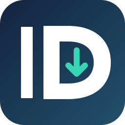

# I-DS — I.os Download Support

**Tool by InShaLIve.os** · Open-source Windows downloader · Python / PyQt6

> Active development. Media downloading and direct HTTP file downloading now work in a Phase 2B beta, but the extension and network recovery still need real-world acceptance before this replaces IDM.

## What works today

- **Desktop media URLs:** Add a supported video/audio URL, choose a real output format and available resolution, and start downloading through the controlled yt-dlp engine.
- **Direct file downloads (Phase 2B beta):** Desktop **File Download** supports HTTP/HTTPS PDFs, ZIPs, images, installers and other files, with progress, safe unique filenames and resumable partials when the server provides validators. Interruption, validator changes and parallel files passed isolated HTTP recovery tests. Edge extension-to-Qt queue handoff passed in an isolated test profile; installed user-profile Chrome/Edge and browser-origin content saving still need acceptance.
- **Chrome/Edge browser companion:** Detect supported on-page media, show an in-player I-DS button, right-click a file link, or opt in to automatic handoff of supported general-file downloads.
- **Download management:** Status, pause/cancel, queue history/recovery logic, speed controls, and completion actions are implemented. Reliability still needs live long-session testing.
- **Media converter:** FFmpeg-based conversions with format validation, progress/cancellation and **Video size** presets (Original, up to 1080p / 720p / 480p / 360p / 240p). Resizing preserves aspect ratio and never upscales. A real FFmpeg 640×480 to 480×360 conversion passed FFprobe and frame decoding.
- **Local pairing:** The extension sends authenticated requests to a loopback-only desktop endpoint. Pairing tokens stay local.

The underlying source and compatibility filenames still use the historical Stratum names to preserve existing configurations and tooling. **On Windows, use `00 - OPEN I-DS` to start the GUI with the I-DS product icon and no persistent command window.** A broken old Start Stratum shortcut was moved to a reversible local backup; do not remove the internal source files.

## Still in development

- Manual Chrome/Edge installed-extension acceptance of opt-in PDF/ZIP/installer handoff and correct resume-to-browser fallback after failed desktop acceptance. Chrome downloads requiring session cookies may not transfer successfully.
- Extended HTTP retry/recovery stress testing, especially large authenticated or expiring signed links (**Phase 2B.1**).
- Further video-detection and site compatibility checks, particularly **YouTube HTTP 403**. A controlled public test video completed through a one-time isolated Android-client retry and passed FFprobe/FFmpeg playback checks. **MP4 download worker verified; MP3 and all websites/videos not yet proven.** Site access and formats can change; DRM-protected content is not supported.
- Polished installer, signed releases, a published browser store extension, and full accessibility/manual desktop acceptance tests.

**Do not install from unrelated websites.** This repository's launcher uses the Python source; it is not a signed Windows installer.

## Quick start on Windows

1. Install **Python 3.14** (recommended; Python 3.10+ is supported where compatible wheels exist) and **FFmpeg** for media conversions.
2. Download this branch using **Code → Download ZIP** and extract it, or clone the repository.
3. Double-click **`SETUP I-DS.cmd`** once (internet required). It checks the desktop GUI and installs verified, isolated media dependencies if needed.
4. Double-click **`00 - OPEN I-DS`** (product logo, no persistent terminal). Setup creates the shortcut. The older `START I-DS.cmd` and `START STRATUM DOWNLOADER.cmd` remain available for compatibility.

To download supported media, select **Add media**. For a direct PDF, ZIP or installer URL, select **Download file**, paste the link and choose the save folder. Existing files are not overwritten.

**New interface:** The first screen offers **Media**, **Files** and **Convert**. The header shows Active / Waiting / Finished jobs. Use the header sidebar icon to collapse or reopen categories, the small sidebar width controls to adjust it, and the **100% / 115% / 130%** control to enlarge text. These preferences are saved.

## Chrome / Edge extension

1. Open `chrome://extensions` (or `edge://extensions`), enable **Developer mode**, and choose **Load unpacked**.
2. Select the repository's **`browser_extension`** folder.
3. In I-DS desktop, open **Options → Browser Integration → Copy Token**.
4. Click the I-DS browser icon and choose **Connect with copied token**. If browser clipboard access is unavailable, expand the manual section and paste the token normally.

The on-video **I-DS** button opens **Download with Options**. Its grip lets you drag it; **−/+** compacts or expands it, and **×** dismisses it for that player. Right-click **Quick Download with I-DS** remains the fast-start alternative. Use **Download file with I-DS** on ordinary links. Under extension settings, optionally enable **Automatically use I-DS for supported browser files**. It is off by default; a failed desktop handoff resumes Chrome. Avoid enabling it for private downloads that depend on browser cookies until live compatibility testing is complete.

The extension requests broad HTTP/HTTPS site access to detect media; browser-side request observations do not copy passwords, cookies, or authorization headers.

## Developer checks

- Python regressions: `python -m pytest -q`
- Browser tests: `node --test browser_extension/*.test.js`
- Read project ownership rules in [AGENTS.md](AGENTS.md) and current verified status in [docs/CURRENT_STATE.md](docs/CURRENT_STATE.md).

## Community

Reports, ideas, and tested site compatibility improvements are welcome through GitHub Issues and pull requests. Please read [CONTRIBUTING.md](CONTRIBUTING.md) and do not post passwords, private links, tokens, or personal download histories.

Licensed under [MIT](LICENSE). Download only content you own or have permission to save.
